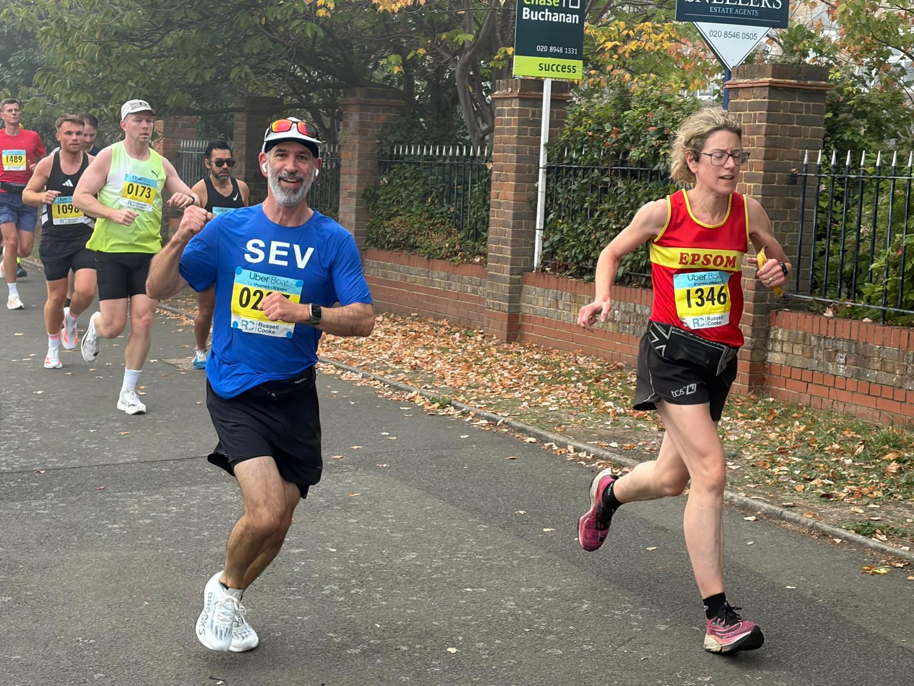

So I do a fair bit of running. With occasional races. Couple of weeks ago had a half marathon, and went for a PB\*.

I trained for this. Not that long, but I came off a big month in August (410km), and switched to a 5 week training plan. Shout out to [Runna](https://runna.com/).

And from the day after hitting my goal, I was like "so I guess that's it for running, I'm done". Ignoring the fact I couldn't go up and down stairs for a bit, I've had this feeling after most (all?) races.

I've often had a similar feeling after hitting a big deadline or doing a big project. You get it all live, you get it done. It may have been a long shift. It may have been late hours. Might have been neither. But it's live.

And then you have this empty feeling. Like you just don't know what to do, what's next. You've lost the ability to think about something new (or start a new training program).

I think this is why proper professional sportspeople often struggle with retirement. You go from being ultra focused to just ... nothing.

Running, they say, you need to pick a new race. Sometimes possible. Sometimes not. Parkruns are useful. Shout out [Parkrun](https://www.parkrun.org.uk/).

I don't think this is about motivation. I guess like running, where you need a physical recovery, you also need a mental recovery after a push.

I find the physical easier than the mental.

I waited two days for the knees to recover, then forced myself out for a 6km. Hated it. But also was ok. Then an 8km, then a 10km. Got to do my Parkrun the following week. Still struggling to want to run like I did a month ago, but I'm forcing the change. Parkrun challenges are helping, they're something to chase.

I guess we all have our own methods of picking ourselves up onto the next thing. If you have anything you think works particularly well, I'd be curious to hear it.

\* Previous PB, same race a year ago was 1:39. Set my watch for 1:35, got **1:34:29**
