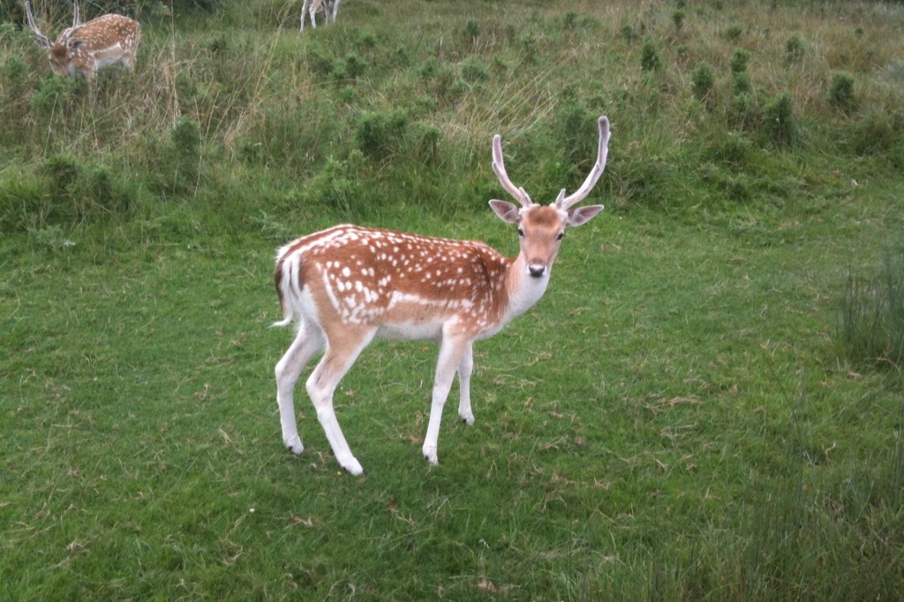

One of these is an African waterbuck and one of these is an English deer.

I run (or drive) through Richmond Park a lot. So I see a lot of deer. And I come from Africa, and have seen a lot of buck. You can see the difference between antlers and horns pretty quickly (the waterbuck's the one with horns). And antlers get shed, horns don't.

I think about this a lot (fine, I'm weird). The difference comes down to where each spends its calories. It takes a lot of energy to grow things, so evolution lands up making sure you've spent those calories growing things that matter. (Note: I'm not an evolutionary biologist, but I'm pretty sure this tracks.)

Business is no different. We spend money instead of calories. We build teams instead of horns. But really, to a degree, it's similar. Survival depends on not wasting energy (money), and so choices are made (deliberate or otherwise) to avoid wasteful spend. (I know, I know, but bear with me.)

Up till recently it didn't make sense building that little interface between two systems when a manual workaround worked. 4 sprints for a squad? That's costing £150-£200k. Turning a spreadsheet\* into a workable app? Well, that's anywhere between £20k and £100k for a contract engineer. Needed to file/tag/filter a bunch of messy data? Well, that always cost a lot.

So we didn't spend calories growing these horns. We accepted a certain amount of toil and pain because even though it was something we could automate, or connect or code, it just wasn't worth it.

Now suddenly the barrier to that has dropped to close to zero.

Which is where antlers get interesting. A deer spends a huge amount of energy growing a new set every year, then just drops them. That only works when growing them is cheap enough to be worth it. Now we can afford antlers: grow the thing you need when you need it and shed it when you don't.

Case in point: I coded an app for my kids to take a photo of their spelling tests, it loads it to a database, calls Google Cloud's TTS and then tests them. (Tracks improvement, tough words etc.) I never was going to pay a dev £20k to code this. I never was going to spend weeks doing this myself. But I could crack it out and have it both work and look good in a few hours. No one is going to pay me £10 a month for this. It's not marketable SaaS. But it is damn useful for a cost of nearly nothing. (Shout out Cloudflare.)

That doesn't mean every problem is solvable with AI, and I'm not saying "this changes everything". But a bunch of areas where calories were costly now aren't, and that sure does change a lot.

The toil we used to just put up with? That's now the cheapest thing to fix.

\* The original no code platform.
